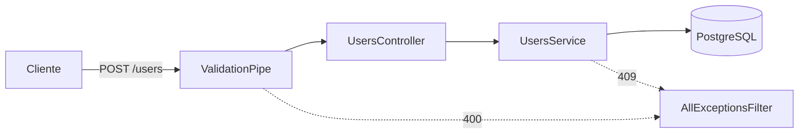

# Registration API

API de cadastro de usuários em **NestJS**, escrita como a versão em NestJS do projeto Java `Microservice_Build_Environment`, mas em uma única aplicação (sem microsserviços).

> **Status:** em desenvolvimento. A API de cadastro, o banco de dados com migrations e a documentação Swagger estão prontos. A mensageria com RabbitMQ e o envio de e-mail ainda serão implementados (veja o [roadmap](#roadmap)).

## Funcionalidades

- `POST /users` cadastra um usuário, com validação dos dados.
- E-mail único: duplicidade retorna `409 Conflict`. O e-mail é normalizado (sem espaços e em minúsculas) antes da checagem.
- Formato de erro padronizado para qualquer falha da API.
- Documentação interativa com Swagger.
- Banco PostgreSQL com schema versionado por migrations do TypeORM.
- Infraestrutura local com Docker Compose.

## Tecnologias

| Em uso | Para quê |
|---|---|
| Node.js 20.19+ (ou 22.12+) e TypeScript | Plataforma e linguagem |
| NestJS | Framework da aplicação |
| TypeORM + PostgreSQL 16 | Acesso a dados e migrations |
| class-validator / class-transformer | Validação e transformação dos DTOs |
| @nestjs/swagger | Documentação OpenAPI |
| Docker Compose | PostgreSQL, RabbitMQ e MailHog locais |

O RabbitMQ e o MailHog já sobem no Docker Compose, mas ainda não são usados pela aplicação.

## Fluxo atual



## Como rodar

### Pré-requisitos

- Node.js 20.19+ (ou 22.12+) e npm
- Docker e Docker Compose

### Passo a passo

```bash
# 1. Clonar o repositório
git clone https://github.com/GustavoSoaresbcge/Registration-API.git
cd Registration-API

# 2. Instalar as dependências
npm install

# 3. Criar o arquivo de variáveis de ambiente
cp .env.example .env

# 4. Subir PostgreSQL, RabbitMQ e MailHog
docker compose up -d

# 5. Aplicar as migrations
npm run migration:run

# 6. Iniciar a API em modo desenvolvimento
npm run start:dev
```

Aguarde os containers ficarem `healthy` (`docker compose ps`) antes do passo 5.

### Endereços locais

| Serviço | Endereço |
|---|---|
| API | http://localhost:3000 |
| Swagger | http://localhost:3000/api |
| Documento OpenAPI (JSON) | http://localhost:3000/api-json |
| PostgreSQL | `localhost:5433` |
| RabbitMQ (painel) | http://localhost:15672 (`guest` / `guest`) |
| MailHog (caixa de entrada) | http://localhost:8025 |

> O PostgreSQL do container é exposto na porta **5433** do host (e não na 5432) para não conflitar com uma instalação local do PostgreSQL. Dentro do Docker, ele continua na 5432.

## Endpoints

### `POST /users`

Cadastra um novo usuário.

**Requisição**

```json
{
  "name": "Maria Silva",
  "email": "maria@email.com"
}
```

**Respostas**

| Status | Quando |
|---|---|
| `201 Created` | Usuário criado |
| `400 Bad Request` | Dados inválidos ou campos não permitidos no body |
| `409 Conflict` | E-mail já cadastrado |

**Exemplo de `201`**

```json
{
  "id": 1,
  "name": "Maria Silva",
  "email": "maria@email.com",
  "createdAt": "2026-11-09T20:07:38.989Z"
}
```

**Formato padrão de erro**

```json
{
  "statusCode": 409,
  "error": "Conflict",
  "message": ["E-mail já cadastrado"],
  "path": "/users",
  "timestamp": "2026-11-09T20:11:41.901Z"
}
```

O campo `message` é sempre uma lista, porque a validação pode apontar mais de um problema de uma vez.

## Banco de dados

O `synchronize` do TypeORM fica **desligado**: o schema só muda por migrations versionadas em `src/database/migrations`.

| Tabela | Descrição |
|---|---|
| `users` | `id`, `name`, `email` (único), `created_at` |
| `email_status` | Status do envio de e-mail por usuário (`PENDING`, `SENT`, `ERROR`) e mensagem de erro. A tabela já existe, mas ainda não é usada pela aplicação |

Scripts de migration:

```bash
npm run migration:generate -- src/database/migrations/NomeDaMigration
npm run migration:run
npm run migration:revert
```

## Estrutura do projeto

```
src/
├── common/
│   ├── dto/          # ErrorResponseDto (formato de erro documentado no Swagger)
│   └── filters/      # AllExceptionsFilter (filtro global de exceções)
├── database/
│   ├── data-source.ts   # DataSource usado pelo CLI das migrations
│   └── migrations/
├── mail/             # Entidade e enum do status de e-mail
├── users/
│   ├── dto/          # CreateUserDto, UserResponseDto
│   ├── user.entity.ts
│   ├── users.controller.ts
│   ├── users.service.ts
│   └── users.module.ts
├── app.module.ts
└── main.ts           # ValidationPipe, filtro global e Swagger
```

## Decisões de projeto

- **Migrations em vez de `synchronize`:** o banco só muda por SQL versionado e revisável.
- **DTO de entrada e de resposta separados da entidade:** a API não expõe a estrutura interna da tabela.
- **`ValidationPipe` com `whitelist` e `forbidNonWhitelisted`:** campos não declarados no DTO são rejeitados com `400`.
- **E-mail normalizado:** `Maria@Email.com` e `maria@email.com` contam como o mesmo cadastro.
- **Constraint `UNIQUE` no banco** além da checagem no service, como garantia final contra duplicidade.

## Scripts úteis

| Comando | O que faz |
|---|---|
| `npm run start:dev` | Inicia a API com recarga automática |
| `npm run build` | Compila o projeto |
| `npm run migration:run` | Aplica as migrations pendentes |
| `docker compose up -d` | Sobe a infraestrutura local |
| `docker compose down` | Para os containers (os dados do banco ficam no volume) |

## Roadmap

- [x] Projeto base, variáveis de ambiente e fluxo de branches com Pull Requests
- [x] Infraestrutura local com Docker Compose (PostgreSQL, RabbitMQ e MailHog, com healthchecks)
- [x] TypeORM, entidades e primeira migration
- [x] `POST /users` com validação, e-mail único e erros padronizados
- [x] Documentação Swagger
- [ ] Publicação do evento de cadastro no RabbitMQ e consumidor que envia o e-mail (Nodemailer + MailHog)
- [ ] Testes com Jest
- [ ] Logs e análise de falhas
- [ ] Dockerfile multi-stage e API dentro do Docker Compose